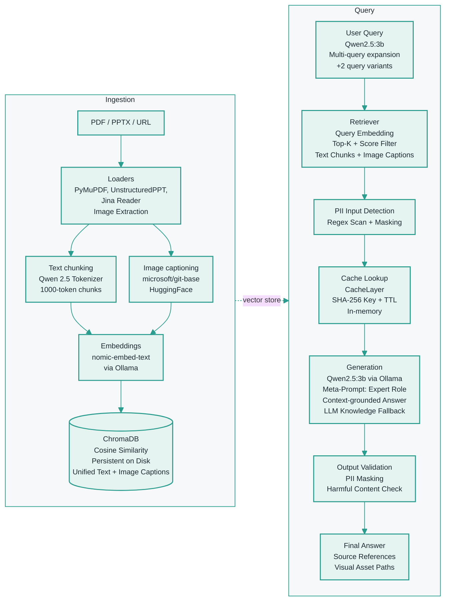
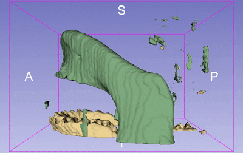
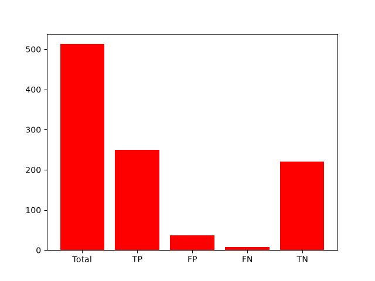
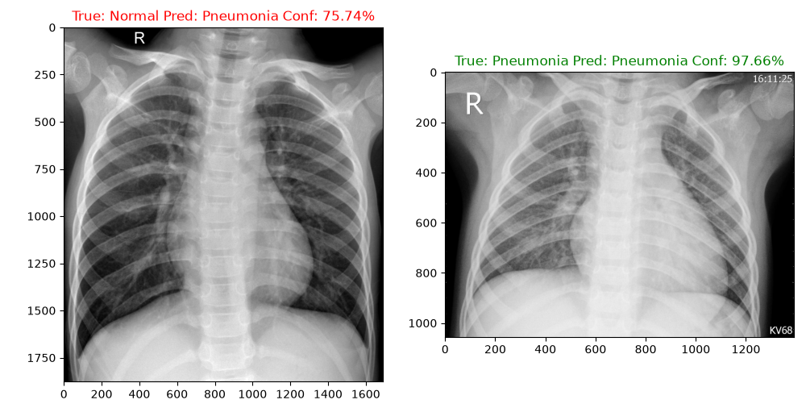
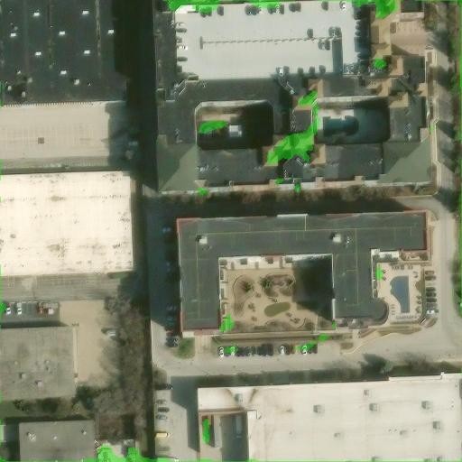
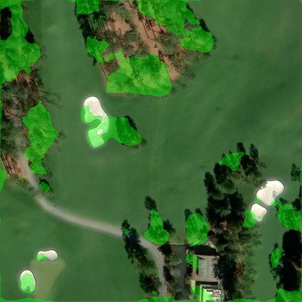

<h1>Aakar Roy</h1>

**AI/ML engineering student building applied systems in computer vision, medical imaging, and LLMs.**

Currently building SamDrishti, an assistive technology project for visually impaired users.

[LinkedIn](https://www.linkedin.com/in/aakar-roy-a689aa333) &nbsp;|&nbsp; [Email](mailto:iamaakarroy@gmail.com) &nbsp;|&nbsp; [Project Portfolio](https://my-projects-aakar-roy.streamlit.app/)

 [Projects](#projects) &nbsp;|&nbsp; [Selected Work](#selected-work)

## Projects

<table>
  <tr>
    <td width="50%" valign="top">
      <h4><a href="https://github.com/aakarroy/vashist.ai">Vashist AI</a></h4>
      
Fully local, privacy-first RAG study assistant over PDFs, slides, and web URLs.

      
<b>Problem:</b> cloud study assistants require uploading personal study material to third-party servers.

      
<b>Approach:</b> an end-to-end local pipeline with document and image ingestion, ChromaDB retrieval, Qwen2.5:3b via Ollama, and PII masking on both input and output.

      
<code>Python</code> <code>RAG</code> <code>Ollama</code> <code>ChromaDB</code>

    </td>
    <td width="50%" valign="top">
      <h4><a href="https://github.com/aakarroy/ToothFairy2">ToothFairy2</a></h4>
      
End-to-end 3D multi-class tooth segmentation on dental CT/CBCT using MONAI and a 3D Residual U-Net.

      
<b>Problem:</b> delineating individual teeth in volumetric dental scans is slow to do by hand.

      
<b>Approach:</b> a 3D Residual U-Net trained with MONAI to segment teeth by class, with a separate jaw-separation output.

      
<code>PyTorch</code> <code>MONAI</code> <code>3D Segmentation</code>

    </td>
  </tr>
  <tr>
    <td width="50%" valign="top">
      <h4><a href="https://github.com/TridibeshSam31/Retail-Store-Agent">Ware Agent</a></h4>
      
Multi-agent system where per-store agents and an arbitrator negotiate inventory rebalancing from ML demand forecasts.

      
<b>Problem:</b> manual, gut-feel stock reordering across a retail chain.

      
<b>Approach:</b> an ML demand forecaster, one agent per store, and a neutral arbitrator that detect shortages, locate surplus elsewhere, and propose a resolution automatically.

      
<i>Team project. My role: designing and implementing the agentic workflow.</i>

      
<code>Python</code> <code>LangGraph</code> <code>Forecasting</code>

      
<a href="https://retail-store-agent.vercel.app/">Live Demo</a>

    </td>
    <td width="50%" valign="top">
      <h4><a href="https://github.com/aakarroy/Open-Vision">Aerial Turf Segmentation (Open Vision)</a></h4>
      
Binary semantic segmentation of turf in aerial imagery with U-Net and YOLOv8, producing GIS-ready outputs.

      
<b>Problem:</b> turf regions in high-resolution aerial imagery need to be identified in a form GIS workflows can use.

      
<b>Approach:</b> U-Net and YOLOv8 architectures for segmentation, with inference outputs designed to be GIS-native.

      
<code>PyTorch</code> <code>U-Net</code> <code>YOLOv8</code>

    </td>
  </tr>
  <tr>
    <td width="50%" valign="top">
      <h4><a href="https://github.com/aakarroy/Pneumonia-Detection">Pneumonia Detection</a></h4>
      
Chest X-ray classification with a custom CNN, deployed as a real-time Streamlit app.

      
<b>Problem:</b> a fast first-pass screening aid for chest X-rays.

      
<b>Approach:</b> a custom CNN in PyTorch, served through a Streamlit interface for real-time prediction, with evaluation metrics shown below.

      
<code>PyTorch</code> <code>CNN</code> <code>Streamlit</code>

    </td>
    <td width="50%" valign="top">
      <h4><a href="https://github.com/aakarroy/Machine-Learning-Algorithms">Machine Learning Algorithms</a></h4>
      
Linear, logistic, and polynomial regression applied to housing, cardiac risk, and manufacturing datasets.

      
<b>Problem:</b> building a solid grounding in core algorithms before moving to deep learning.

      
<b>Approach:</b> each algorithm applied end to end to a real dataset, including a StandardScaler and PolynomialFeatures pipeline for the polynomial model.

      
<code>scikit-learn</code> <code>Pandas</code> <code>Seaborn</code>

    </td>
  </tr>
</table>

## Selected Work

### Vashist AI: system architecture

A local retrieval pipeline with security and caching built in. Every stage runs on the user's machine.

### ToothFairy2: 3D segmentation output

  <table>
    <tr>
      <td width="50%" align="center">
        
         Multi-class tooth segmentation (FDI labels)
      </td>
      <td width="50%" align="center">
        
         Upper and lower jaw separation
      </td>
    </tr>
  </table>

### Pneumonia Detection: metrics and predictions

<table>
  <tr>
    <td width="50%" align="center">
      
       Prediction metrics
    </td>
    <td width="50%" align="center">
      
       Sample prediction on test data
    </td>
  </tr>
</table>

### Open Vision: aerial turf segmentation

<table>
  <tr>
    <td width="50%" align="center">
      
       Test result 1
    </td>
    <td width="50%" align="center">
      
       Test result 2
    </td>
  </tr>
</table>
