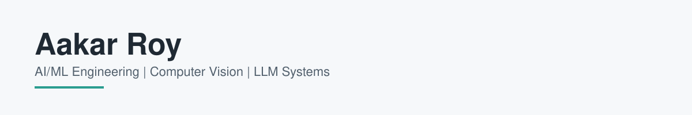
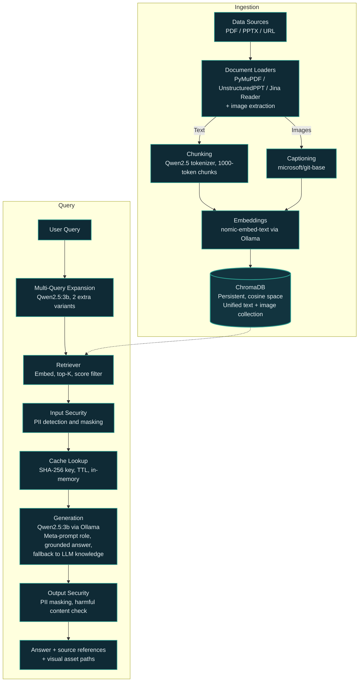
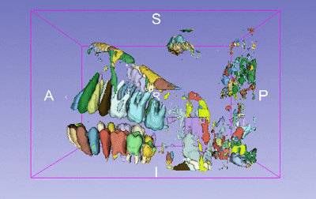

<picture>
  <source media="(prefers-color-scheme: dark)" srcset="assets/banner-dark.svg">
  <source media="(prefers-color-scheme: light)" srcset="assets/banner-light.svg">
  
</picture>

  <a href="#projects">Projects</a> &nbsp;|&nbsp;
  <a href="#selected-work">Selected Work</a> &nbsp;|&nbsp;
  <a href="#technical-stack">Stack</a> &nbsp;|&nbsp;
  <a href="#contact">Contact</a>

---

## About

AI/ML engineering student building applied machine learning systems across computer vision, medical imaging, and LLM-based applications. Currently building SamDrishti, an assistive technology project for visually impaired users.

---

## Projects

<table>
  <tr>
    <td width="50%" valign="top">
      <h4><a href="https://github.com/aakarroy/vashist.ai">Vashist AI</a></h4>
      
Fully local, privacy-first RAG study assistant over PDFs, slides, and web URLs.

      
<code>Python</code> <code>RAG</code> <code>Ollama</code> <code>ChromaDB</code>

    </td>
    <td width="50%" valign="top">
      <h4><a href="https://github.com/aakarroy/ToothFairy2">ToothFairy2</a></h4>
      
End-to-end 3D multi-class tooth segmentation on dental CT/CBCT using MONAI and a 3D Residual U-Net.

      
<code>PyTorch</code> <code>MONAI</code> <code>3D Segmentation</code>

    </td>
  </tr>
  <tr>
    <td width="50%" valign="top">
      <h4><a href="https://github.com/TridibeshSam31/Retail-Store-Agent">Ware Agent</a></h4>
      
Multi-agent system where per-store agents and an arbitrator negotiate inventory rebalancing from ML demand forecasts.

      
<code>Python</code> <code>LangGraph</code> <code>Forecasting</code>

    </td>
    <td width="50%" valign="top">
      <h4><a href="https://github.com/aakarroy/Open-Vision">Aerial Turf Segmentation</a></h4>
      
Binary semantic segmentation of turf in aerial imagery with U-Net and YOLOv8, producing GIS-ready outputs.

      
<code>PyTorch</code> <code>U-Net</code> <code>YOLOv8</code>

    </td>
  </tr>
  <tr>
    <td width="50%" valign="top">
      <h4><a href="https://github.com/aakarroy/Pneumonia-Detection">Pneumonia Detection</a></h4>
      
Chest X-ray classification with a custom CNN, deployed as a real-time Streamlit app.

      
<code>PyTorch</code> <code>CNN</code> <code>Streamlit</code>

    </td>
    <td width="50%" valign="top">
      <h4><a href="https://github.com/aakarroy/Machine-Learning-Algorithms">Machine Learning Algorithms</a></h4>
      
Linear, logistic, and polynomial regression applied to housing, cardiac risk, and manufacturing datasets.

      
<code>scikit-learn</code> <code>Pandas</code> <code>Seaborn</code>

    </td>
  </tr>
</table>

---

## Selected Work

### Vashist AI: system architecture

### ToothFairy2: segmentation output

  

### Pneumonia Detection: prediction results

  

---

## Technical Stack

| Area | Tools |
|---|---|
| Languages |    |
| Deep Learning |     |
| LLM and Agents |      |
| ML and Data |    |
| Deployment |  |

---

## Contact

[LinkedIn](https://www.linkedin.com/in/aakar-roy-a689aa333) | [Email](mailto:iamaakarroy@gmail.com) | [Project Portfolio](https://my-projects-aakar-roy.streamlit.app/)